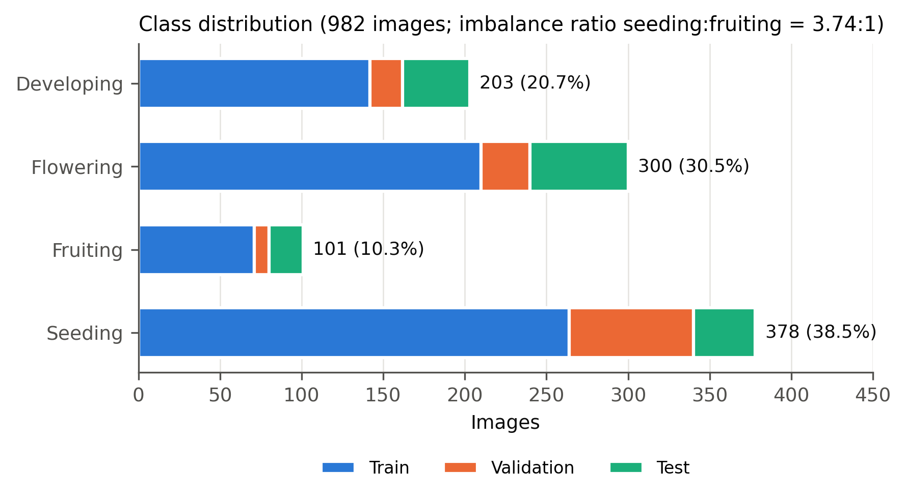
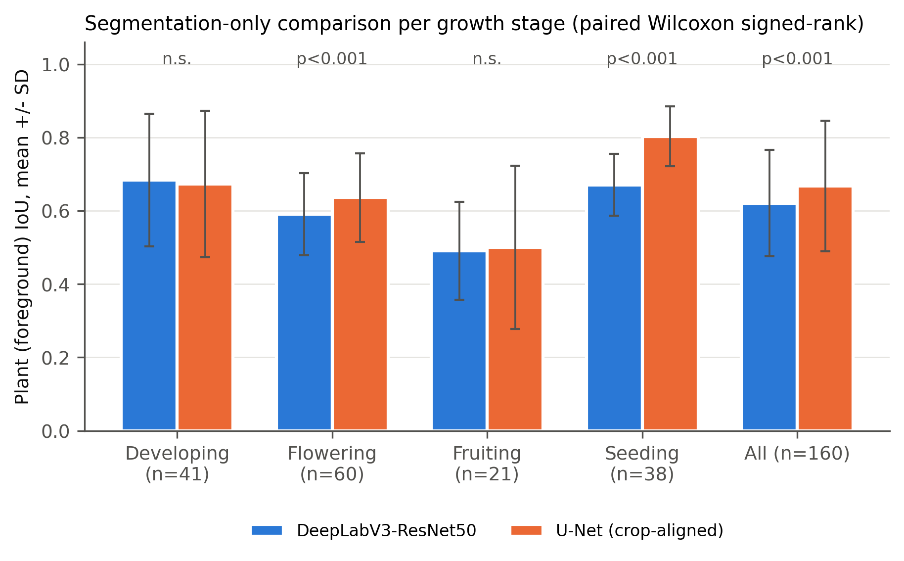
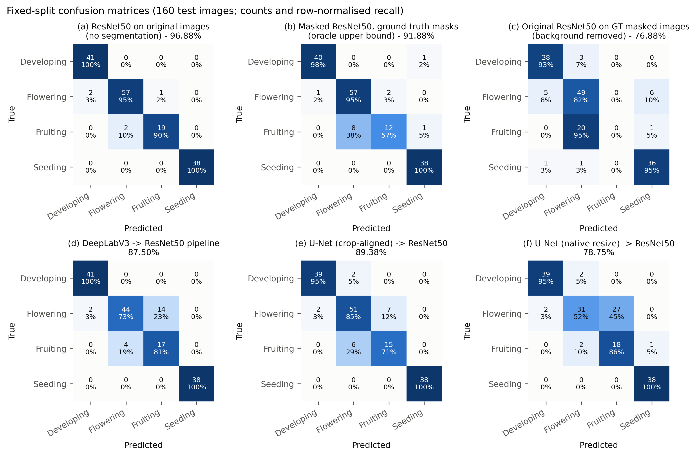
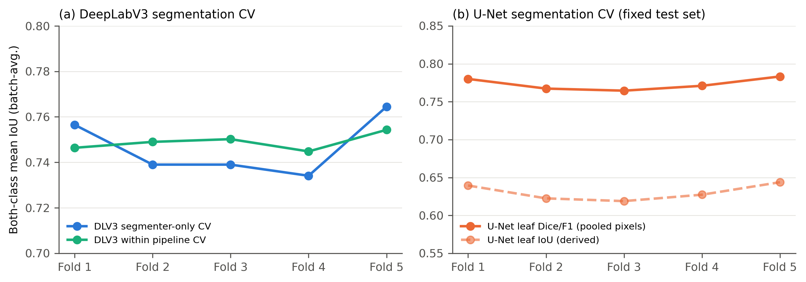
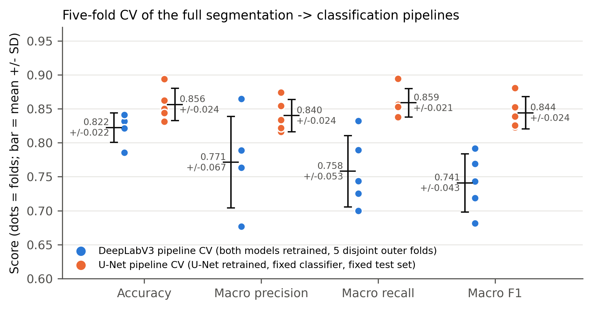
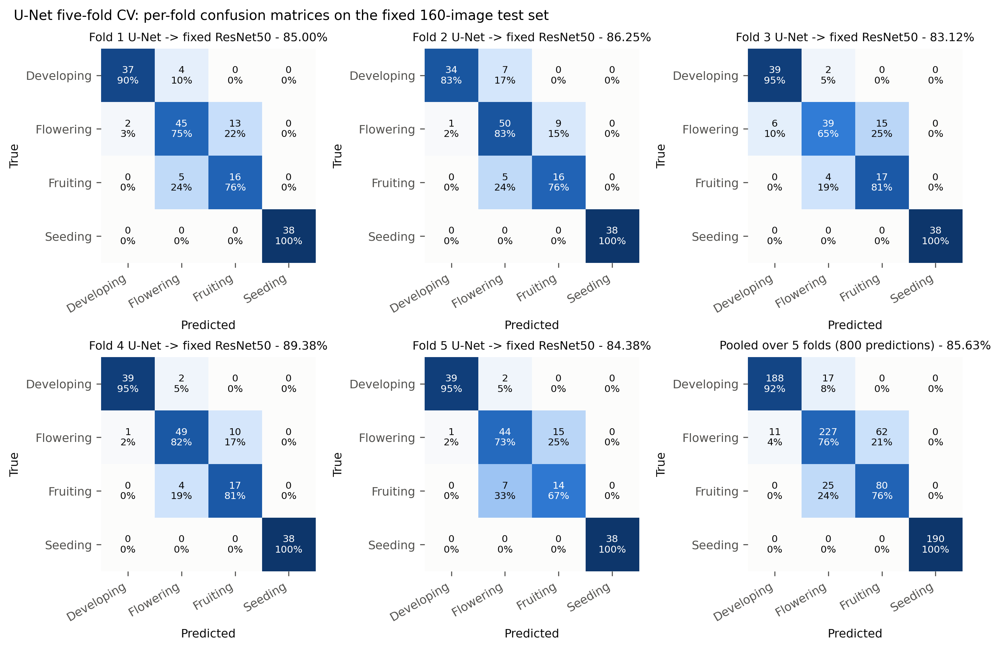
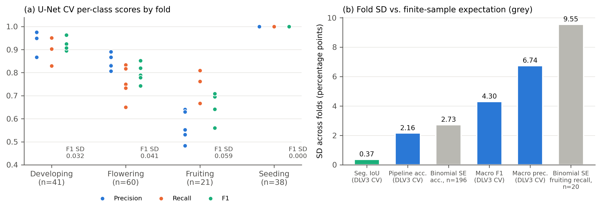

# Leaf Segmentation for Tomato Growth-Stage Classification: U-Net vs. DeepLabV3 Pipelines with a ResNet50 Classifier

**Complete results and evidence report for manuscript preparation**

Prepared 9 October 2026 from the `Resnet50test` and `Unet` project workspaces. No model was retrained for this report. All saved numbers were re-read from CSV, JSON and notebook outputs. Missing confusion matrices and per-image predictions were recovered by *inference-only* re-scoring of the saved checkpoints. Every re-scored run reproduced its originally saved accuracy exactly (Section 2.4). Paired significance tests and the variance analysis in Section 8 are new computations on those recovered predictions.

---

## Contents

1. Study design at a glance
2. Dataset, class imbalance and evidence provenance
3. Models and pipelines (methods)
4. Evaluation metrics and statistical procedures
5. Results I: segmentation models only (U-Net vs. DeepLabV3)
6. Results II: complete segmentation → classification pipelines (fixed split)
7. Results III: cross-validation (segmentation and pipelines)
8. Why the standard deviations look the way they do (small data + class imbalance)
9. Full comparison summary
10. Limitations and threats to validity
11. Paper-ready text (abstract, results, discussion)
12. Evidence index and reproducibility

---

## 1. Study design at a glance

The study asks three questions:

- **RQ1 (segmentation only):** How well do a pretrained DeepLabV3-ResNet50 and a from-scratch U-Net separate tomato plant pixels from background?
- **RQ2 (pipelines):** When the predicted mask removes the background before a ResNet50 growth-stage classifier, which segmenter produces the better pipeline, and how close does it get to the background-intact ResNet50 baseline and to the ground-truth-mask ("oracle") upper bound?
- **RQ3 (robustness):** How stable are these results under five-fold cross-validation (CV), and what drives the fold-to-fold standard deviation (SD)?

| Model / pipeline | Role | Input to classifier |
|---|---|---|
| ResNet50 (original) | Baseline classifier, no segmentation | Full RGB image (background intact) |
| ResNet50 (masked) | Classifier used inside every pipeline | RGB image with background set to black |
| Masked ResNet50 + ground-truth mask | Oracle upper bound | Image masked by annotated polygons |
| **DeepLabV3-ResNet50 → masked ResNet50** | Deployable pipeline A | Image masked by DeepLabV3 prediction |
| **U-Net → masked ResNet50** | Deployable pipeline B | Image masked by U-Net prediction |

The four growth stages are **developing, flowering, fruiting and seeding**. The repository label is "seeding"; confirm whether the paper should say "seedling".

---

## 2. Dataset, class imbalance and evidence provenance

### 2.1 Composition



*Figure 1. Images per growth stage and split. Fruiting is the smallest class (10.3%) and seeding the largest (38.5%).*

| Growth stage | Train | Validation | Test | Total | Share | Ratio to fruiting |
|---|---:|---:|---:|---:|---:|---:|
| Developing | 142 | 20 | 41 | 203 | 20.7% | 2.01 |
| Flowering | 210 | 30 | 60 | 300 | 30.5% | 2.97 |
| Fruiting | 71 | 9 | 21 | 101 | 10.3% | 1.00 |
| Seeding | 264 | 76 | 38 | 378 | 38.5% | 3.74 |
| **Total** | **687** | **135** | **160** | **982** | 100% | — |

- **Size:** 982 self-collected images, annotated in Roboflow with COCO plant polygons. Three developing training images have no polygon annotation. All segmentation work and the DeepLabV3 CV therefore use **979 annotated images**, and the masked training set has 684 images.
- **Imbalance:** the maximum-to-minimum class ratio is **3.74 : 1** (seeding : fruiting). This is a **moderate** imbalance rather than an extreme one. The decisive factor is the small *absolute* number of fruiting images (101 in total). That leaves only 9 validation and 21 test fruiting images in the fixed split, and about 20 per outer fold in CV.
- **Split mismatch:** the class mix of the fixed test set (25.6% developing, 37.5% flowering, 13.1% fruiting, 23.8% seeding) differs from the full dataset. Stratified CV folds instead follow the full-dataset mix, with about 38.6% seeding. This difference matters when accuracy is compared across protocols (Section 8.5).
- **No imbalance handling:** no class weighting, resampling or focal loss was used. Every classifier was trained with plain `CrossEntropyLoss()` (verified in all training notebooks).
- **Leakage check:** the baseline export metadata records an audit for leakage across the fixed train, validation and test splits (MD5, Roboflow source filename and perceptual hash over all 982 images). It also records a 10 July 2026 correction that moved two mislabelled images from flowering to fruiting.

### 2.2 Evidence provenance and verification

| Evidence | Origin | Verification |
|---|---|---|
| Fold-level CV metrics (DeepLabV3 segmenter-only, DeepLabV3 full pipeline, U-Net segmentation, U-Net pipeline) | Saved CSVs | Means and SDs recomputed |
| Fixed-split segmentation metrics | Saved comparison CSV/JSON and notebook outputs | Reproduced exactly by re-scoring (Section 2.4) |
| U-Net fixed-split per-image predictions | Saved CSV | Confusion matrix rebuilt and matched |
| **U-Net CV per-fold confusion matrices** (new) | Re-scoring the 5 saved fold checkpoints | Fold accuracies 0.85000 / 0.86250 / 0.83125 / 0.89375 / 0.84375, identical to the saved CSV |
| **ResNet50 2×2 background ablation confusion matrices** (new) | Re-scoring saved checkpoints | Accuracies 0.96875 / 0.76875 / 0.35625 / 0.91875, identical to the saved CSV |
| **Per-image DeepLabV3 vs. U-Net scores on identical images and geometry** (new) | Re-scoring saved checkpoints | Plant IoU 0.6204 / 0.6674, Dice 0.7536 / 0.7827, accuracy 87.50% / 89.38%, all identical to saved values |
| DeepLabV3 CV per-fold confusion matrices | **Not available**: fold checkpoints and predictions were not saved | Cannot be recovered without retraining |

### 2.3 Fixed-split results that have more than one saved value

- **DeepLabV3 pipeline:** an earlier comparison run recorded **84.38%**, using an earlier classifier/segmenter state. The current saved checkpoints give **87.50%** (export metadata, standalone notebook and this report's re-scoring all agree). This report uses **87.50%** as the DeepLabV3 fixed-split result and lists 84.38% only for provenance.
- **Original ResNet50:** the `resnet50.ipynb` output shows **93.13%** from an earlier run. The exported checkpoint, used in every later experiment, scores **96.88%**. The export metadata records non-determinism across identical-seed runs (95.6–97.5%) before deterministic cuDNN was enabled.

### 2.4 Hardware and software

NVIDIA GeForce RTX 4060 Laptop GPU; PyTorch 2.6.0+cu124; torchvision 0.21.0+cu124; scikit-learn; seed 42 throughout.

---

## 3. Models and pipelines (methods)

### 3.1 ResNet50 growth-stage classifiers

| Setting | Value |
|---|---|
| Backbone | torchvision ResNet50, ImageNet-1K V2 weights, final FC replaced by `Linear(2048, 4)`, whole network fine-tuned |
| Parameters | 23,516,228 trainable |
| Input / eval preprocessing | Resize(255) → CenterCrop(224) → ImageNet mean/std normalisation |
| Training augmentation | RandomResizedCrop(224, scale 0.8–1.0), horizontal flip, rotation ±15°, ColorJitter(0.2, 0.2, 0.2) |
| Optimiser / LR | Adam, 1×10⁻⁴; ReduceLROnPlateau (factor 0.5, patience 2, on validation loss) |
| Batch / epochs | 32 / 20; checkpoint with best validation accuracy |
| Loss | Cross-entropy (unweighted) |
| Original model | Trained on full RGB images; best epoch 19; validation accuracy 0.9556 |
| Masked model | Same recipe, trained on images masked by **ground-truth** polygons; best epoch 14; validation accuracy 0.9778 |

### 3.2 DeepLabV3-ResNet50 segmenter

| Setting | Value |
|---|---|
| Architecture | torchvision `deeplabv3_resnet50` (ASPP head, ResNet50 backbone), pretrained weights; main and auxiliary heads replaced by 2-class (background/plant) 1×1 convolutions |
| Parameters | 41,994,308 trainable |
| Loss | Cross-entropy on main head + 0.4 × auxiliary-head cross-entropy |
| Optimiser | Adam 1×10⁻⁴, ReduceLROnPlateau on validation loss |
| Batch / epochs | 16 / 15 (fixed split); best checkpoint by validation both-class IoU |
| Geometry | Resize(255) → CenterCrop(224), shared with the classifier |
| Mask rule | argmax over the two classes |
| Training run | Best validation IoU 0.797 at epoch 15; 12 min 9 s |

### 3.3 U-Net segmenter

| Setting | Value |
|---|---|
| Architecture | Custom U-Net (Ronneberger et al., 2015), trained **from scratch**. Four encoder blocks (32-64-128-256), 512-channel bottleneck, transposed-convolution decoder with concatenated skips, 1-channel logits |
| Parameters | 7,765,985 (5.4× fewer than DeepLabV3) |
| Loss | 0.5 × BCEWithLogits + 0.5 × (1 − soft Dice) |
| Optimiser | Adam 1×10⁻⁴, ReduceLROnPlateau on validation Dice (factor 0.5, patience 5), mixed precision |
| Batch / epochs | 8 / 60; best epoch 58 (validation soft Dice 0.813) |
| Augmentation | Paired horizontal/vertical flips and 90°/180°/270° rotations |
| Native geometry | Direct (aspect-distorting) resize to 224×224 |
| Mask rule | sigmoid > 0.5 |

### 3.4 The two segmentation → classification pipelines

```
RGB image ─► Resize(255) ─► CenterCrop(224) ─► [0,1] tensor ─┬─► normalise ─► SEGMENTER ─► binary plant mask
                                                              │                                    │
                                                              └──────────── pixel-wise × ◄─────────┘
                                                                                   │
                                                              masked RGB ─► normalise ─► masked ResNet50 ─► stage
```

- **Pipeline A (DeepLabV3):** the DeepLabV3 mask feeds the masked ResNet50 exported with the DeepLabV3 pipeline.
- **Pipeline B (U-Net, crop-aligned):** the U-Net mask feeds the masked ResNet50 checkpoint. Export metadata records this classifier as identical to Pipeline A's; checkpoint hashes were not compared. U-Net receives the same Resize→CenterCrop crop as the classifier.
- **Pipeline B′ (U-Net, native):** U-Net receives its own training geometry (direct resize). This variant was superseded and is reported as an ablation.
- **Design properties:** the pipelines are **sequential**, with no joint training. The classifier is trained on *ground-truth* masks and tested on *predicted* masks; this is the deployable route for unannotated photos.

### 3.5 Cross-validation protocols

The two CV studies were designed differently, so their SDs measure different sources of variation (Section 8.4).

| | DeepLabV3 segmenter-only CV | DeepLabV3 **full-pipeline** CV | U-Net CV (segmentation + pipeline) |
|---|---|---|---|
| Image pool | 979 annotated (train+val+test pooled) | 979 annotated (pooled) | 822 (train+val); fixed 160-image test set held out |
| Splitter | KFold(5, shuffle, seed 42) | **StratifiedKFold**(5, shuffle, seed 42) by stage | **StratifiedKFold**(5, shuffle, seed 42) by stage |
| Per fold | 665–666 train / 118 inner-val / 195–196 outer test | Same sizes | 657–658 train / 164–165 val; scored on the fixed 160 test images |
| Retrained per fold | Segmenter (10 epochs) | Segmenter (10 epochs) **and** classifier (12 epochs) | U-Net only (30 epochs, no LR scheduler) |
| Classifier | — | Fresh ImageNet ResNet50, trained on GT-masked images | Fixed masked ResNet50 (not retrained) |
| Test images per fold | Disjoint outer folds | Disjoint outer folds | **Same** 160 images in every fold |
| Saved outputs | Fold metrics | Fold metrics (no per-class metrics or confusion matrices) | Fold metrics, per-class metrics, fold checkpoints (confusion matrices recovered here) |

The original ResNet50 was also cross-validated (export metadata): 5-fold stratified CV over the 822 train+validation images, 10 epochs per fold, scored on the fixed 160-image test set.

---

## 4. Evaluation metrics and statistical procedures

### 4.1 Metric definitions

- **Segmentation (binary, plant = positive):**
  - Plant IoU = TP/(TP+FP+FN)
  - Plant Dice = 2TP/(2TP+FP+FN)
  - Both-class mean IoU = mean of background IoU and plant IoU
  - Pixel accuracy = (TP+TN)/all pixels
- **Aggregation conventions:**
  - The paired comparison in Section 5 averages **per image**.
  - The DeepLabV3 CV notebook averages both-class IoU **per batch**.
  - The U-Net CV scores **pooled pixels**; its plant IoU is derived from pooled F1 as IoU = F1/(2 − F1).
  - These aggregations are *not interchangeable*, so each table states which one it uses.
- **Classification:**
  - Accuracy = correct images / all images.
  - Macro precision, recall and F1 are unweighted means over the four stages, so each stage counts 25% regardless of its size.

### 4.2 Statistics

- **CV summaries:** mean ± **sample SD** (denominator K − 1 = 4) across folds. 95% intervals use the t-distribution, t₀.₉₇₅,₄ = 2.776.
- **Fixed-split accuracy:** 95% Wilson score intervals.
- **Paired segmentation comparison:** Wilcoxon signed-rank test on per-image plant IoU, both models scored on the same 160 images, same geometry and same ground truth. A 10,000-sample bootstrap gives the CI of the mean difference.
- **Paired pipeline comparison:** exact McNemar test on per-image correct/incorrect outcomes.

---

## 5. Results I: segmentation models only (U-Net vs. DeepLabV3)

### 5.1 Fixed-split segmentation, 160 test images

All three rows were scored on the same 160 test images. Rows 1 and 3 share identical geometry and ground truth, so the paired test applies to them.

| Segmenter (geometry) | Plant IoU | Plant Dice | Both-class IoU | Pixel accuracy | Parameters |
|---|---:|---:|---:|---:|---:|
| DeepLabV3-ResNet50 (crop) | 0.6204 | 0.7536 | 0.7475 | 0.9007 | 42.0 M |
| U-Net, native resize | 0.6646 | 0.7844 | 0.7926 | — | 7.8 M |
| **U-Net, crop-aligned** | **0.6674** | **0.7827** | **0.7753** | — | 7.8 M |

**Paired test, U-Net (crop-aligned) − DeepLabV3:**

| Quantity | Value |
|---|---|
| Mean plant-IoU difference | **+0.0470** (bootstrap 95% CI +0.0296 to +0.0636) |
| Median difference | +0.0538 |
| Images where U-Net is better | 118 / 160 (73.8%) |
| Wilcoxon, plant IoU | W = 2973, **p = 3.5 × 10⁻⁹** |
| Wilcoxon, plant Dice | W = 3195, **p = 3.2 × 10⁻⁸** |

### 5.2 Segmentation quality by growth stage



*Figure 4. Per-image plant IoU (mean ± SD) by growth stage for DeepLabV3 and crop-aligned U-Net on identical images. p-values are from paired Wilcoxon signed-rank tests.*

| Stage (n) | DeepLabV3 IoU (mean ± SD) | U-Net IoU (mean ± SD) | Δ (U − D) | Wilcoxon p |
|---|---:|---:|---:|---:|
| Developing (41) | 0.6840 ± 0.1811 | 0.6730 ± 0.1998 | −0.0110 | 0.68 (n.s.) |
| Flowering (60) | 0.5906 ± 0.1121 | 0.6362 ± 0.1208 | +0.0456 | 8.2 × 10⁻⁵ |
| Fruiting (21) | **0.4904 ± 0.1339** | **0.4998 ± 0.2227** | +0.0094 | 0.26 (n.s.) |
| Seeding (38) | 0.6706 ± 0.0847 | 0.8031 ± 0.0820 | **+0.1325** | 1.8 × 10⁻¹⁰ |

Saved stage-wise Dice values: DeepLabV3 0.7936 / 0.7353 / 0.6444 / 0.7996; crop-aligned U-Net 0.7816 / 0.7696 / 0.6318 / 0.8881 (developing / flowering / fruiting / seeding). For native-resize U-Net, plant IoU is 0.6865 / 0.6307 / 0.5181 / 0.7755.

**Reading:**

- U-Net's advantage is concentrated in **seeding** (small, sparse plants) and **flowering**.
- On **fruiting**, both segmenters are at their worst (IoU ≈ 0.49–0.50) and neither has an advantage.
- Fruiting also shows the largest per-image dispersion for U-Net (SD 0.22). Fruiting masks are therefore the least reliable input to the classifier, the same class that has the fewest images.

### 5.3 DeepLabV3 pixel-classification detail (fixed split)

| Level | Pixel accuracy | Precision | Recall | F1 |
|---|---:|---:|---:|---:|
| Macro (background/plant) | 0.9010 | 0.8466 | 0.8626 | 0.8542 |
| Background | — | 0.9450 | 0.9289 | 0.9368 |
| Plant | — | 0.7482 | 0.7963 | 0.7715 |

The validation split (135 images) gave plant IoU 0.6433 ± 0.1165, Dice 0.7764 ± 0.0926 and pixel accuracy 0.9363.

The original U-Net export reports test binary IoU 0.6650 and **soft** Dice 0.7572. Soft Dice is probability-based and must not be mixed with binary Dice.

---

## 6. Results II: complete segmentation → classification pipelines (fixed split)

### 6.1 Overall

| Pipeline / reference | Accuracy (95% Wilson CI) | Macro P | Macro R | Macro F1 | Correct / 160 |
|---|---:|---:|---:|---:|---:|
| ResNet50, original images (no segmentation) | 96.88% (92.9–98.7) | 0.9674 | 0.9637 | 0.9653 | 155 |
| Masked ResNet50 + **ground-truth** masks (oracle) | 91.88% (86.6–95.2) | 0.9149 | 0.8743 | 0.8869 | 147 |
| **U-Net (crop-aligned) → ResNet50** | **89.38% (83.6–93.3)** | 0.8744 | 0.8789 | 0.8765 | 143 |
| **DeepLabV3 → ResNet50** | **87.50% (81.5–91.8)** | 0.8546 | 0.8857 | 0.8612 | 140 |
| U-Net (native resize) → ResNet50 | 78.75% (71.8–84.4) | 0.80 | 0.83 | 0.78 | 126 |
| Original ResNet50 on GT-masked images | 76.88% | 0.5930 | 0.6727 | 0.6300 | 123 |
| Masked ResNet50 on original images | 35.63% | 0.1780 | 0.4405 | 0.2526 | 57 |

Macro values for the four ResNet50 reference rows come from the re-scored predictions (N1). Original ResNet50 class F1: developing 0.976, flowering 0.958, fruiting 0.927, seeding 1.000. Oracle class F1: 0.976 / 0.912 / **0.686** / 0.974. The earlier DeepLabV3 comparison run recorded 84.38%; see Section 2.3.

**Paired McNemar test, U-Net vs. DeepLabV3 pipelines** (same 160 images):

| Outcome | Images |
|---|---:|
| Both correct | 127 |
| Only U-Net correct | 16 |
| Only DeepLabV3 correct | 13 |
| Both wrong | 4 |

Exact McNemar **p = 0.71**. The 1.88-point accuracy difference is **not statistically significant**. On the fixed split, the two pipelines are statistically indistinguishable, even though U-Net segments significantly better (Section 5.1).

### 6.2 Per-class results

| Stage (support) | U-Net P / R / F1 | DeepLabV3 P / R / F1 | U-Net native F1 | Original ResNet50 F1 |
|---|---|---|---:|---:|
| Developing (41) | 0.951 / 0.951 / 0.951 | 0.954 / **1.000** / **0.976** | 0.951 | 0.98 |
| Flowering (60) | 0.864 / **0.850** / **0.857** | **0.917** / 0.733 / 0.815 | 0.653 | 0.96 |
| Fruiting (21) | **0.682** / 0.714 / **0.698** | 0.548 / **0.810** / 0.654 | 0.546 | 0.93 |
| Seeding (38) | 1.000 / 1.000 / 1.000 | 1.000 / 1.000 / 1.000 | 0.987 | 1.00 |

### 6.3 Confusion matrices (fixed split)



*Figure 2. Confusion matrices on the 160-image test set (rows = true, columns = predicted; count and row-normalised recall). (a) Original ResNet50. (b) Oracle (ground-truth mask). (c) Original ResNet50 with the background removed. (d) DeepLabV3 pipeline. (e) U-Net crop-aligned pipeline. (f) U-Net native-resize pipeline.*

The tables give the same matrices in text form (rows = true D/Fl/Fr/S, columns = predicted D/Fl/Fr/S).

| (a) ResNet50 original | D | Fl | Fr | S |
|---|---:|---:|---:|---:|
| Developing | 41 | 0 | 0 | 0 |
| Flowering | 2 | 57 | 1 | 0 |
| Fruiting | 0 | 2 | 19 | 0 |
| Seeding | 0 | 0 | 0 | 38 |

| (b) Oracle masked | D | Fl | Fr | S |
|---|---:|---:|---:|---:|
| Developing | 40 | 0 | 0 | 1 |
| Flowering | 1 | 57 | 2 | 0 |
| Fruiting | 0 | 8 | 12 | 1 |
| Seeding | 0 | 0 | 0 | 38 |

| (c) Original model, background removed | D | Fl | Fr | S |
|---|---:|---:|---:|---:|
| Developing | 38 | 3 | 0 | 0 |
| Flowering | 5 | 49 | 0 | 6 |
| Fruiting | 0 | 20 | **0** | 1 |
| Seeding | 1 | 1 | 0 | 36 |

| (d) DeepLabV3 pipeline | D | Fl | Fr | S |
|---|---:|---:|---:|---:|
| Developing | 41 | 0 | 0 | 0 |
| Flowering | 2 | 44 | **14** | 0 |
| Fruiting | 0 | 4 | 17 | 0 |
| Seeding | 0 | 0 | 0 | 38 |

| (e) U-Net crop-aligned pipeline | D | Fl | Fr | S |
|---|---:|---:|---:|---:|
| Developing | 39 | 2 | 0 | 0 |
| Flowering | 2 | 51 | 7 | 0 |
| Fruiting | 0 | 6 | 15 | 0 |
| Seeding | 0 | 0 | 0 | 38 |

| (f) U-Net native pipeline | D | Fl | Fr | S |
|---|---:|---:|---:|---:|
| Developing | 39 | 2 | 0 | 0 |
| Flowering | 2 | 31 | **27** | 0 |
| Fruiting | 0 | 2 | 18 | 1 |
| Seeding | 0 | 0 | 0 | 38 |

Masked ResNet50 on *original* (unmasked) images collapses: rows D [41 0 0 0], Fl [56 0 4 0], Fr [5 0 16 0], S [13 0 25 0], i.e. 35.63%.

**Key observations:**

1. **Seeding is solved by every pipeline** (38/38). All pipeline errors lie on the developing–flowering–fruiting continuum.
2. **The flowering ↔ fruiting boundary dominates the errors:**
   - 18 of DeepLabV3's 20 errors.
   - 13 of U-Net's 17 errors.
   - 29 of native U-Net's 34 errors.
3. **The two pipelines make different mistakes:**
   - DeepLabV3 over-predicts fruiting: 14 flowering images are called fruiting, giving fruiting recall 0.81 with precision 0.55.
   - U-Net is more balanced: 7 flowering → fruiting and 6 fruiting → flowering.
4. **Preprocessing geometry matters more than mask overlap.**
   - Native and crop-aligned U-Net have almost identical IoU (0.665 vs. 0.667), yet accuracy rises from 78.75% to 89.38%.
   - Flowering recall rises from 0.52 to 0.85.
   - Aligning the segmenter's frame with the classifier's frame removed 20 flowering → fruiting errors.
5. **Background context carries information.**
   - Removing the background from the original classifier's input destroys fruiting recognition (0/21; panel c).
   - Even with perfect masks, the masked classifier reaches only 12/21 on fruiting (panel b).
   - Masking therefore costs about 5 points against the 96.88% baseline, even under oracle masks. The predicted-mask pipelines lose a further 2.5–4.4 points.
6. **The background-dependence ablation is inferred from accuracy, not from attention.** Grad-CAM attention outside the plant mask was 0.71 ± 0.14 for the original model and 0.73 ± 0.15 for the masked model (`gradcam_background_attention_fraction.png`). Grad-CAM therefore does not, on its own, show a difference in background reliance; the conclusion rests on the 2×2 accuracy ablation.

---

## 7. Results III: cross-validation

### 7.1 Segmentation CV



*Figure 7. Fold-level segmentation scores. (a) DeepLabV3: both-class batch-averaged IoU from the segmenter-only CV and from the segmentation stage of the full-pipeline CV. (b) U-Net: pooled leaf Dice/F1 and derived leaf IoU on the fixed test set.*

**DeepLabV3, segmenter-only five-fold CV** (979 images, disjoint outer folds):

| Fold | Both-class IoU | Pixel acc. | Macro P | Macro R | Macro F1 | Best val. IoU |
|---|---:|---:|---:|---:|---:|---:|
| 1 | 0.7565 | 0.9177 | 0.8507 | 0.8620 | 0.8562 | 0.7442 |
| 2 | 0.7390 | 0.9119 | 0.8600 | 0.8385 | 0.8486 | 0.7268 |
| 3 | 0.7390 | 0.9039 | 0.8507 | 0.8315 | 0.8406 | 0.7511 |
| 4 | 0.7341 | 0.9130 | 0.8472 | 0.8317 | 0.8391 | 0.7541 |
| 5 | 0.7645 | 0.9130 | 0.8549 | 0.8609 | 0.8578 | 0.7516 |
| **Mean ± SD** | **0.7466 ± 0.0131** | **0.9119 ± 0.0050** | 0.8527 ± 0.0049 | 0.8449 ± 0.0154 | 0.8485 ± 0.0086 | 0.7456 ± 0.0111 |

**DeepLabV3, segmentation stage of the full-pipeline CV** (stratified folds):

| Fold | Both-class IoU | Pixel acc. | Macro P | Macro R | Macro F1 | Best val. IoU |
|---|---:|---:|---:|---:|---:|---:|
| 1 | 0.7464 | 0.9075 | 0.8412 | 0.8496 | 0.8453 | 0.7415 |
| 2 | 0.7490 | 0.9107 | 0.8455 | 0.8482 | 0.8469 | 0.7546 |
| 3 | 0.7502 | 0.9100 | 0.8559 | 0.8368 | 0.8459 | 0.7516 |
| 4 | 0.7448 | 0.9128 | 0.8670 | 0.8234 | 0.8428 | 0.7434 |
| 5 | 0.7543 | 0.9143 | 0.8625 | 0.8347 | 0.8476 | 0.7585 |
| **Mean ± SD** | **0.7489 ± 0.0037** | **0.9111 ± 0.0026** | 0.8544 ± 0.0110 | 0.8385 ± 0.0108 | 0.8457 ± 0.0018 | 0.7499 ± 0.0073 |

**U-Net, five-fold CV** (each fold's U-Net scored on the fixed 160-image test set; pooled pixels):

| Fold | Leaf precision | Leaf recall | Leaf Dice/F1 | Leaf IoU (derived) | Pixel acc. | Best val. soft Dice |
|---|---:|---:|---:|---:|---:|---:|
| 1 | 0.7379 | 0.8274 | 0.7801 | 0.6394 | 0.9307 | 0.7337 |
| 2 | 0.7273 | 0.8120 | 0.7673 | 0.6225 | 0.9268 | 0.7237 |
| 3 | 0.6787 | 0.8753 | 0.7646 | 0.6189 | 0.9199 | 0.7092 |
| 4 | 0.7277 | 0.8198 | 0.7710 | 0.6273 | 0.9277 | 0.6847 |
| 5 | 0.7724 | 0.7945 | 0.7833 | 0.6438 | 0.9347 | 0.7380 |
| **Mean ± SD** | 0.7288 ± 0.0335 | 0.8258 ± 0.0302 | **0.7732 ± 0.0081** | **0.6304 ± 0.0108** | **0.9280 ± 0.0054** | 0.7179 ± 0.0216 |

On each fold's own validation subset (also used for checkpoint selection), U-Net scored leaf F1 0.7835 ± 0.0126 and pixel accuracy 0.9454 ± 0.0060. Background F1 on the test set was 0.9572 ± 0.0036.

**Segmentation CV interpretation:** both segmenters are **very stable** across folds. Relative SD (SD/mean) is 0.5–1.8% for DeepLabV3 IoU and 1.0% for U-Net Dice. Absolute CV values cannot be ranked across the two models because the aggregation (batch-averaged both-class IoU vs. pooled foreground F1), the data pool and the epoch budgets differ. The paired fixed-split test in Section 5.1 is the valid head-to-head comparison.

### 7.2 Full-pipeline CV



*Figure 5. Fold-level pipeline scores (dots) with mean ± SD. Blue = DeepLabV3 full-pipeline CV; orange = U-Net CV with the fixed classifier.*

**DeepLabV3 → ResNet50, both models retrained per fold** (disjoint outer folds of 195–196 images):

| Fold | Accuracy | Macro P | Macro R | Macro F1 | Classifier best val. acc. |
|---|---:|---:|---:|---:|---:|
| 1 | 0.8316 | 0.7887 | 0.8320 | 0.7916 | 0.9068 |
| 2 | 0.8316 | 0.7628 | 0.7893 | 0.7690 | 0.9237 |
| 3 | 0.8214 | 0.7632 | 0.7250 | 0.7188 | 0.9237 |
| 4 | 0.7857 | 0.6765 | 0.7000 | 0.6813 | 0.9237 |
| 5 | 0.8410 | 0.8648 | 0.7438 | 0.7433 | 0.8814 |
| **Mean ± SD** | **0.8223 ± 0.0216** | **0.7712 ± 0.0674** | **0.7580 ± 0.0527** | **0.7408 ± 0.0430** | 0.9119 ± 0.0185 |
| 95% t-CI | 0.796–0.849 | — | — | 0.687–0.794 | — |

**U-Net → fixed masked ResNet50** (same 160 test images per fold):

| Fold | Accuracy | Macro P | Macro R | Macro F1 | Correct / 160 |
|---|---:|---:|---:|---:|---:|
| 1 | 0.8500 | 0.8334 | 0.8536 | 0.8386 | 136 |
| 2 | 0.8625 | 0.8545 | 0.8561 | 0.8525 | 138 |
| 3 | 0.8313 | 0.8161 | 0.8527 | 0.8228 | 133 |
| 4 | 0.8938 | 0.8739 | 0.8944 | 0.8809 | 143 |
| 5 | 0.8438 | 0.8220 | 0.8378 | 0.8254 | 135 |
| **Mean ± SD** | **0.8563 ± 0.0238** | **0.8400 ± 0.0239** | **0.8589 ± 0.0211** | **0.8441 ± 0.0237** | 137 ± 3.8 |
| 95% t-CI | 0.827–0.886 | — | — | 0.815–0.874 | — |

**U-Net CV, per-class mean ± SD across folds:**

| Stage (n) | Precision | Recall | F1 | F1 range |
|---|---:|---:|---:|---:|
| Developing (41) | 0.9474 ± 0.0464 | 0.9171 ± 0.0534 | 0.9305 ± 0.0315 | 0.895–0.963 |
| Flowering (60) | 0.8455 ± 0.0332 | 0.7567 ± 0.0732 | 0.7966 ± 0.0415 | 0.743–0.852 |
| **Fruiting (21)** | **0.5671 ± 0.0668** | **0.7619 ± 0.0583** | **0.6491 ± 0.0586** | **0.560–0.708** |
| Seeding (38) | 1.0000 ± 0.0000 | 1.0000 ± 0.0000 | 1.0000 ± 0.0000 | 1.000–1.000 |

**Reference: original ResNet50 classifier CV** (no segmentation; export metadata):

| Fold | 1 | 2 | 3 | 4 | 5 | Mean ± SD |
|---|---:|---:|---:|---:|---:|---:|
| Validation acc. | 0.9273 | 0.9455 | 0.9451 | 0.9024 | 0.9268 | 0.9294 ± 0.0158 |
| Test acc. (160) | 0.9563 | 0.9625 | 0.9625 | **0.8750** | 0.9563 | **0.9425 ± 0.0339** |

The 5-fold ensemble reached 0.9563. The metadata attributes the fold-4 outlier to fruiting images.

### 7.3 Cross-validated confusion matrices (U-Net)



*Figure 3. Confusion matrices for each U-Net CV fold model with the fixed classifier on the 160 test images, plus the pooled matrix (800 predictions). Recovered by inference-only re-scoring of the saved fold checkpoints; accuracies match the saved CSV exactly.*

**Pooled U-Net CV matrix (5 folds × 160 images):**

| True \ Pred | Developing | Flowering | Fruiting | Seeding | Recall |
|---|---:|---:|---:|---:|---:|
| Developing (205) | **188** | 17 | 0 | 0 | 0.917 |
| Flowering (300) | 11 | **227** | **62** | 0 | 0.757 |
| Fruiting (105) | 0 | **25** | **80** | 0 | 0.762 |
| Seeding (190) | 0 | 0 | 0 | **190** | 1.000 |
| Precision | 0.945 | 0.845 | **0.563** | 1.000 | acc. 0.856 |

Of the 115 pooled errors, **87 (75.7%) are flowering ↔ fruiting** (62 + 25) and 28 are developing ↔ flowering. None involve seeding.

Fold-level fruiting row and column:

| Fold | Fruiting correct / 21 | Flowering → fruiting | Fruiting → flowering | Fruiting precision |
|---|---:|---:|---:|---:|
| 1 | 16 | 13 | 5 | 0.552 |
| 2 | 16 | 9 | 5 | 0.640 |
| 3 | 17 | 15 | 4 | 0.531 |
| 4 | 17 | 10 | 4 | 0.630 |
| 5 | 14 | 15 | 7 | 0.483 |

Per-fold confusion matrices are **not available for the DeepLabV3 full-pipeline CV**: fold checkpoints and per-image predictions were not saved. Producing them would require rerunning that CV with prediction logging (Section 10).

---

## 8. Why the standard deviations look the way they do

**Short answer:** the hypothesis is supported by the evidence, with one refinement. The fold-to-fold SD is driven mainly by **the small number of images**, especially the **~20 fruiting images per test fold**, combined with **class imbalance**. The imbalance matters because fruiting sits next to a class three times its size (flowering). Five pieces of quantitative evidence follow, plus one design factor.



*Figure 6. (a) U-Net CV per-class precision, recall and F1 across the five folds: seeding has zero spread, and fruiting has the lowest scores and the largest spread. (b) Observed fold SDs (blue/green) against the SD expected from finite test-set size alone (grey, binomial standard error).*

### 8.1 Evidence 1: the SD hierarchy matches a small-sample, minority-class mechanism

| Quantity (DeepLabV3 full-pipeline CV unless stated) | Fold SD | Relative SD |
|---|---:|---:|
| Segmentation IoU (pixels, binary, ~9.8 M pixels/fold) | 0.37 pp | 0.5% |
| U-Net segmentation Dice (fixed test) | 0.81 pp | 1.0% |
| Pipeline accuracy (196 images/fold) | 2.16 pp | 2.6% |
| Pipeline macro F1 | 4.30 pp | 5.8% |
| Pipeline macro recall | 5.27 pp | 7.0% |
| Pipeline macro precision | **6.74 pp** | **8.7%** |

The SD grows **20-fold** from segmentation to macro precision.

- **Segmentation is stable:** its metrics average over millions of pixels and treat all stages as one "plant" class, so they barely move between folds.
- **Accuracy depends on about 196 images per fold.**
- **Macro metrics give the 20 fruiting images the same 25% weight as the 76 seeding images**, so they inherit the noise of the smallest class.

### 8.2 Evidence 2: accuracy SD equals what test-set size alone predicts

- **DeepLabV3 CV:** for an accuracy of p ≈ 0.82 measured on n = 196 images, the binomial sampling SE is √(p(1−p)/n) = **2.73 pp**. The observed fold SD is **2.16 pp**. The entire accuracy spread is therefore explained by having only ~196 test images per fold; no model instability needs to be invoked.
- **U-Net CV:** the test images never change, so its 2.38 pp SD (about ±4 images out of 160) comes from retraining U-Net on a different 80% of only 822 images. This is again a data-quantity effect: each fold model sees a slightly different, small training set.

### 8.3 Evidence 3: one fruiting image moves macro metrics 2.4× more than accuracy

| Stage | Images per outer test fold | Weight of 1 image in accuracy | Weight of 1 image in macro recall | Ratio |
|---|---:|---:|---:|---:|
| Developing | ~40 | 0.51 pp | 0.63 pp | 1.23× |
| Flowering | ~60 | 0.51 pp | 0.42 pp | 0.82× |
| **Fruiting** | **~20** | 0.51 pp | **1.24 pp** | **2.43×** |
| Seeding | ~76 | 0.51 pp | 0.33 pp | 0.65× |

- One fruiting image changes fruiting recall by **~5 pp**.
- The binomial SE of a 0.76 recall measured on 20–21 images is **9.3–9.5 pp**.
- Observed fold SD of U-Net fruiting recall is 5.8 pp, and of fruiting precision 6.7 pp.

This is why DeepLabV3's macro precision ranges from 0.677 (fold 4) to 0.865 (fold 5) while its accuracy ranges only 0.786–0.841. Fold 5 has high precision but low recall (0.865 / 0.744), the typical signature of a classifier that rarely predicts the minority class. Fold 4 has low values on both, consistent with minority-class errors.

### 8.4 Evidence 4: imbalance between neighbouring classes inflates fruiting precision variance

- **The confusable pair is unevenly sized:** flowering (60 test images) is visually adjacent to fruiting (21) and is **2.9× larger**. A small leakage rate from the large class becomes a large share of the small class's predictions.
- **Size of the effect:** in the pooled U-Net CV matrix, 20.7% of flowering evaluations (62 of 300) were predicted as fruiting. That equals **78% of the 80 true fruiting hits**, which drags fruiting precision to **0.563**.
- **Fold-to-fold swing:** flowering → fruiting leakage varies between 9 and 15 images per fold, and fruiting precision swings between **0.48 and 0.64**.
- **Seeding has no such neighbour.** Visually distinct and the largest class, it has **zero** variance in every fold of every pipeline. Developing has low variance.
- **Variance is local:** it sits almost entirely in the smallest class and its larger neighbour, which is the signature of class imbalance acting on a small dataset.

### 8.5 Evidence 5: the minority class is also data-starved during training

- **Few fruiting training images:**
  - 71 in the fixed split.
  - About 101 × 0.8 × 0.85 ≈ **69** in each DeepLabV3 CV inner-training set.
  - About **64** in each U-Net CV training fold.
- **No imbalance correction:** no class weighting or resampling was used, so the loss is dominated by seeding (≈3.7× more samples) and flowering.
- **Shorter CV training:** the DeepLabV3 CV classifier trained for only 12 epochs (20 on the fixed split).
- **Larger accuracy–F1 gap in the DeepLabV3 CV:** accuracy 82.2% vs. macro F1 74.1%, an 8.1-point gap; U-Net CV shows 1.2 points. The CV folds contain ~38.6% seeding, which is classified perfectly, so seeding props up accuracy while macro F1 exposes the weaker minority classes.
- **The weakness persists even with perfect masks:** the oracle classifier still scores only 12/21 on fruiting (Figure 2b). Part of the fruiting difficulty is therefore intrinsic: few examples and fine, flower-like visual cues once the background is removed. It is not only a segmentation problem.
- **No masking needed for the effect:** the baseline ResNet50, without segmentation, shows the same pattern. Its CV SD is 3.39 pp, with a single fold at 87.5% attributed to fruiting.

### 8.6 Design factor: the two CV studies measure different variance

| Source of variance | DeepLabV3 full-pipeline CV | U-Net CV |
|---|:---:|:---:|
| Different test images per fold (sampling) | ✔ | ✘ (same 160) |
| Segmenter retrained per fold | ✔ | ✔ |
| Classifier retrained per fold | ✔ | ✘ (fixed) |
| Test-fold class mix | ~20 fruiting / ~76 seeding | 21 fruiting / 38 seeding |

DeepLabV3's larger macro SD (4.3–6.7 pp vs. 2.1–2.4 pp) is **expected by design**: it accumulates three variance sources against U-Net's one. It is *not* evidence that DeepLabV3 is less stable as a segmenter. As segmenters, both are equally stable (Section 7.1).

### 8.7 Suggested wording for the paper

> "Fold-to-fold variability was small for segmentation (SD ≤ 1.3 IoU points) but larger for growth-stage classification, particularly for macro-averaged metrics (SD 4.3–6.7 points in the full-pipeline CV). Two properties of the dataset explain this pattern. First, the dataset is small: with about 196 images per outer test fold, the binomial standard error of accuracy alone is 2.7 points, matching the observed SD of 2.2 points. Second, the classes are imbalanced (seeding : fruiting = 3.74 : 1), leaving only about 20 fruiting images per test fold. Each fruiting image therefore shifts fruiting recall by about 5 points and macro recall 2.4 times more than accuracy. Because fruiting is visually adjacent to the three-times-larger flowering class, small changes in flowering → fruiting leakage (9–15 images per fold) produced large swings in fruiting precision (0.48–0.64). Seeding, the largest and most visually distinct class, was classified perfectly in every fold, so variance was confined to the minority class and its neighbour."

---

## 9. Full comparison summary

### 9.1 Segmentation models only

| Criterion | DeepLabV3-ResNet50 | U-Net (from scratch) | Winner |
|---|---|---|---|
| Parameters | 42.0 M (ImageNet/COCO pretrained) | 7.8 M (no pretraining) | U-Net (5.4× smaller) |
| Fixed-split plant IoU (paired, same geometry) | 0.6204 | **0.6674** | **U-Net, p = 3.5 × 10⁻⁹** |
| Fixed-split plant Dice | 0.7536 | **0.7827** | U-Net, p = 3.2 × 10⁻⁸ |
| Fixed-split both-class IoU | 0.7475 | **0.7753** | U-Net |
| Best stage | Developing (0.684) | Seeding (0.803) | — |
| Worst stage | Fruiting (0.490) | Fruiting (0.500) | Tie (p = 0.26) |
| CV stability (relative SD) | 0.5–1.8% (IoU) | 1.0% (Dice) | Both stable |
| CV mean (own protocol) | Both-class IoU 0.747–0.749 | Leaf Dice 0.773; leaf IoU 0.630 | Not comparable (different metrics and protocols) |

### 9.2 Complete pipelines

| Criterion | DeepLabV3 → ResNet50 | U-Net → ResNet50 | Note |
|---|---|---|---|
| Fixed-split accuracy | 87.50% | **89.38%** | McNemar p = 0.71 (n.s.) |
| Fixed-split macro F1 | 0.8612 | **0.8765** | — |
| Flowering F1 | 0.815 | **0.857** | DeepLabV3 over-predicts fruiting |
| Fruiting F1 | 0.654 | **0.698** | Weakest class for both |
| Developing F1 | **0.976** | 0.951 | — |
| CV accuracy | 82.23 ± 2.16% (full retrain) | 85.63 ± 2.38% (fixed classifier) | Different protocols (Section 8.6) |
| CV macro F1 | 0.741 ± 0.043 | 0.844 ± 0.024 | Different protocols |
| Gap to oracle (91.88%) | −4.38 pp | −2.50 pp | — |
| Gap to unmasked ResNet50 (96.88%) | −9.38 pp | −7.50 pp | — |
| Sensitivity to preprocessing | Uses shared geometry by design | 78.75% native → 89.38% aligned | Frame alignment is critical |

### 9.3 What the evidence supports

1. **U-Net segments tomato plants significantly better than DeepLabV3** on the fixed test set, with 5.4× fewer parameters and no pretraining. The gain is concentrated in seeding and flowering.
2. **Better segmentation did not translate into a significantly better pipeline.** U-Net's +1.9-point accuracy edge is not significant (McNemar p = 0.71, 29 discordant images).
3. **Aligning the segmenter's input geometry with the classifier's mattered more than segmentation overlap:** a 10.6-point accuracy change at near-constant IoU.
4. **Both predicted-mask pipelines approach the oracle-mask bound** (within 2.5–4.4 points) but remain below the unmasked ResNet50 (96.88%). Background context carries real growth-stage information in this dataset, and masking removes it (Section 6.3, point 5).
5. **Seeding is solved; flowering ↔ fruiting is the open problem**, causing 76% of CV errors. It is aggravated by fruiting's small sample size and imbalance against flowering.
6. **Cross-validated variability is dominated by small-sample effects and the minority class**, not by segmentation instability (Section 8).

---

## 10. Limitations and threats to validity

1. **Cross-validation protocols are not matched.**
   - U-Net CV retrains only the segmenter and scores a fixed test set.
   - DeepLabV3 full-pipeline CV retrains both models on pooled data.
   - Their CV means must not be used to rank the architectures. A matched study would use identical outer folds, retrain both models per fold and log per-image predictions.
2. **No DeepLabV3 CV confusion matrices or per-class CV metrics.** The fold models were not saved.
3. **Image-level splits.** Independence by plant, session or camera is not established, so CV estimates internal, not external, generalisation. The original test set is pooled into the DeepLabV3 CV.
4. **Training budgets differ** between protocols: U-Net 60 vs. 30 epochs (CV without scheduler); DeepLabV3 15 vs. 10; classifier 20 vs. 12. Fixed-split and CV numbers are not repeated measurements of one protocol.
5. **Metric aggregation differs** across saved evaluations (per-image, per-batch, pooled pixels; soft vs. binary Dice). Section 5.1 is the only strictly like-for-like segmentation comparison.
6. **Train/test mask mismatch.** Classifiers are trained on ground-truth masks and tested on predicted masks. Training on out-of-fold predicted masks is an untested alternative.
7. **No imbalance mitigation was tried.** Class-weighted loss, balanced sampling, focal loss or fruiting-targeted augmentation are natural next experiments, given Section 8.
8. **Single dataset; no external validation;** a single seed per configuration.

---

## 11. Paper-ready text

### 11.1 Abstract (draft)

> Accurate growth-stage recognition supports tomato crop management, but image classifiers can exploit background context rather than the plant itself. We evaluated sequential segmentation → classification pipelines in which a predicted plant mask removes the background before a ResNet50 growth-stage classifier (developing, flowering, fruiting, seeding). The dataset contains 982 annotated tomato images with a 3.74 : 1 class imbalance. Two segmenters were compared: a pretrained DeepLabV3-ResNet50 (42.0 M parameters) and a U-Net trained from scratch (7.8 M parameters). On a held-out set of 160 images, U-Net achieved significantly higher plant IoU than DeepLabV3 (0.667 vs. 0.620; paired Wilcoxon p < 10⁻⁸). The complete pipelines reached 89.4% (U-Net) and 87.5% (DeepLabV3) accuracy, a non-significant difference (McNemar p = 0.71). Both lie within 2.5–4.4 points of a ground-truth-mask upper bound (91.9%). Aligning the segmenter's input geometry with the classifier's raised U-Net pipeline accuracy from 78.8% to 89.4% at constant IoU. In five-fold cross-validation, segmentation was highly stable (IoU SD ≤ 0.013). Pipeline accuracy was 82.2 ± 2.2% (DeepLabV3, both models retrained) and 85.6 ± 2.4% (U-Net, fixed classifier). Variability concentrated in macro-averaged metrics (SD up to 6.7 points) and was traced to the small minority class: fruiting has about 20 images per fold and is confused with the three-times-larger flowering class, which accounts for 76% of errors. Seeding was classified perfectly in every fold.

### 11.2 Results paragraphs (draft)

**Segmentation.** "Under identical preprocessing and ground truth, the U-Net produced higher plant IoU than DeepLabV3-ResNet50 on 118 of 160 test images. The mean IoU difference was +0.047 (bootstrap 95% CI 0.030–0.064; Wilcoxon p = 3.5 × 10⁻⁹), and the Dice difference was likewise significant (0.783 vs. 0.754; p = 3.2 × 10⁻⁸). The advantage came from seedling-stage (+0.133, p < 10⁻⁹) and flowering images (+0.046, p < 10⁻⁴). Neither model was superior on developing or fruiting images, and fruiting images were the hardest to segment for both (IoU ≈ 0.49–0.50). In five-fold CV, both segmenters were stable: DeepLabV3 both-class IoU 0.747 ± 0.013 (segmenter-only) and 0.749 ± 0.004 (within the pipeline CV); U-Net leaf Dice 0.773 ± 0.008."

**Pipelines.** "With background removed by predicted masks, the U-Net and DeepLabV3 pipelines achieved 89.4% (143/160) and 87.5% (140/160) accuracy, respectively (macro F1 0.877 vs. 0.861). The paired difference was not significant (exact McNemar p = 0.71; 16 vs. 13 discordant images). Both approached the 91.9% obtained with ground-truth masks, and both remained below the 96.9% of a classifier trained and tested on unmasked images. Seedling images were always classified correctly, and most errors were flowering–fruiting confusions (18/20 for DeepLabV3, 13/17 for U-Net). DeepLabV3 tended to label flowering plants as fruiting (14 cases), whereas U-Net errors were symmetric (7 vs. 6). Feeding U-Net the same resize-and-crop geometry as the classifier raised accuracy from 78.8% to 89.4%, with flowering recall rising from 0.52 to 0.85, even though IoU was unchanged (0.665 vs. 0.667)."

**Cross-validation.** "In five-fold CV with both models retrained per fold, the DeepLabV3 pipeline achieved 82.2 ± 2.2% accuracy and 0.741 ± 0.043 macro F1 (95% CI 0.687–0.794). Five independently trained U-Nets, paired with the fixed classifier, achieved 85.6 ± 2.4% accuracy and 0.844 ± 0.024 macro F1 on the fixed test set. Because the two protocols differ in what is retrained and what is tested, these means are reported descriptively rather than ranked. Across the 800 U-Net CV predictions, 76% of errors were flowering ↔ fruiting confusions. Fruiting F1 was 0.649 ± 0.059, against 1.000 ± 0.000 for seeding."

### 11.3 Discussion points (draft)

- **Segmentation quality is necessary but not sufficient.** The significantly better U-Net masks produced only a non-significant pipeline gain. Mask–classifier geometric compatibility changed accuracy five times more than the IoU gap did. Pipeline studies should therefore report downstream metrics and preprocessing explicitly, not IoU alone.
- **A lightweight from-scratch U-Net is competitive with a pretrained DeepLabV3** for binary plant segmentation on this dataset, at 18% of the parameters. This is relevant for field and edge deployment.
- **Background removal costs accuracy here.** The unmasked classifier (96.9%) outperformed every masked pipeline, and removing the background from its inputs cut fruiting recall to 0/21. Masking makes predictions depend on the plant and improves interpretability, but surrounding context (fruit clusters, trusses, support structures, soil) evidently carries stage information. The trade-off between robustness and accuracy should be stated explicitly.
- **Variance and the fruiting class are data problems.** The observed accuracy SD equals the binomial expectation for about 196 test images, and the macro-metric SD tracks the roughly 20 fruiting images per fold. More fruiting images (or targeted augmentation) and imbalance-aware training are the most direct improvements, followed by grouped or external validation.

---

## 12. Evidence index and reproducibility

| ID | File | Content |
|---|---|---|
| E1 | `Resnet50test/unet_vs_deeplabv3_comparison_v2.csv` | Fixed-split segmentation and pipeline comparison |
| E2 | `Resnet50test/deeplabv3_report_tables.json` | DeepLabV3 validation, test and per-stage segmentation metrics |
| E3 | `Resnet50test/checkpoints_segmentation/deeplabv3_kfold_cv_results.csv` | DeepLabV3 segmenter-only CV |
| E4 | `Resnet50test/deeplabv3_pipeline_kfold_cv_results.csv` | DeepLabV3 full-pipeline CV |
| E5 | `Unet/outputs/cross_validation/unet_segmentation_cv_results.csv` | U-Net segmentation CV |
| E6 | `Unet/outputs/cross_validation/fusion_pipeline_cv_results.csv` | U-Net pipeline CV incl. per-class metrics |
| E7 | `Unet/outputs/fusion_pipeline/full_pipeline_test_results.csv` | U-Net per-image fixed-split predictions |
| E8 | `Resnet50test/masked_vs_original_comparison.csv` | Background ablation (2×2) |
| E9 | `Resnet50test/export/metadata.json` | ResNet50 training details and classifier CV |
| E10 | `Resnet50test/export_leaf_pipeline/leaf_pipeline_metadata.json`, `export_leaf_pipeline_unet/metadata.json` | Pipeline exports |
| E11 | `Resnet50test/leaf_segmentation.ipynb`, `unet_leaf_pipeline_comparison.ipynb`, `deeplabv3_pipeline_evaluation.ipynb`, `resnet50*.ipynb`; `Unet/unet_cross_validation.ipynb` | Training and evaluation code with saved outputs |
| **N1** | `paper_report/data/recomputed_cms.json` | **New:** U-Net CV fold and pooled confusion matrices; ResNet50 2×2 ablation matrices and per-class metrics |
| **N2** | `paper_report/data/paired_rows.json` | **New:** per-image IoU, Dice and predictions for DeepLabV3 and U-Net on identical images |
| N3 | `paper_report/data/recompute_cms.py`, `paired_eval.py` | Inference-only re-scoring scripts used to produce N1–N2 |
| N4 | `scripts/build_paper_figures.py` | Regenerates Figures 1–7 from E1–E8 and N1–N2 |

**Re-running:**

```
python paper_report/data/recompute_cms.py paper_report/data/recomputed_cms.json
python paper_report/data/paired_eval.py   paper_report/data/paired_rows.json
python scripts/build_paper_figures.py
python scripts/build_paper_report_docx.py
```

**References for methods:**

- Ronneberger, O., Fischer, P., Brox, T. (2015). *U-Net: Convolutional Networks for Biomedical Image Segmentation.* MICCAI.
- Chen, L.-C., Papandreou, G., Schroff, F., Adam, H. (2017). *Rethinking Atrous Convolution for Semantic Image Segmentation* (DeepLabV3). arXiv:1706.05587.
- He, K., Zhang, X., Ren, S., Sun, J. (2016). *Deep Residual Learning for Image Recognition.* CVPR.
- McNemar, Q. (1947). *Note on the sampling error of the difference between correlated proportions or percentages.* Psychometrika 12, 153–157.
- Wilcoxon, F. (1945). *Individual comparisons by ranking methods.* Biometrics Bulletin 1, 80–83.
