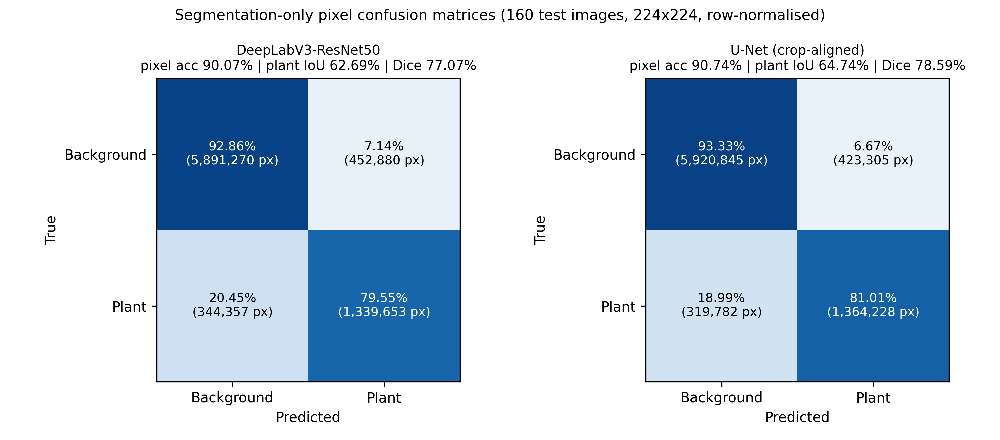
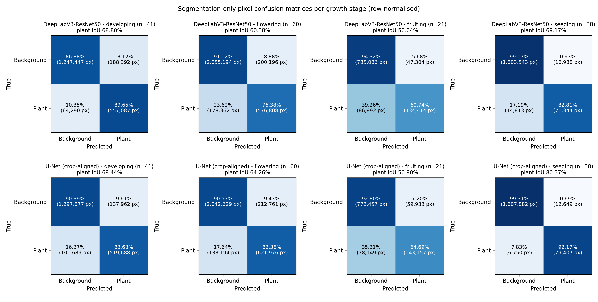

# Sequential Segmentation → Mask → Classification Pipelines: Results

**U-Net and DeepLabV3-ResNet50 segmenters feeding a masked ResNet50 tomato growth-stage classifier**

This document collects every result for the sequential pipelines, with the corresponding figures. All numbers come from the saved checkpoints and outputs described in the full results report (`PAPER_RESULTS_REPORT`). No model was retrained. The four growth stages are developing, flowering, fruiting and seeding.

---

## 1. Pipeline design

### 1.1 How the pipeline works

Each pipeline runs in three sequential steps, with no joint training:

1. **Segment:** a segmenter predicts a binary plant/background mask.
2. **Mask:** the mask is multiplied pixel-wise with the RGB image, so all background pixels become black.
3. **Classify:** a ResNet50, trained on images masked by ground-truth polygons, predicts the growth stage from the masked image.

```
RGB image ─► Resize(255) ─► CenterCrop(224) ─► [0,1] tensor ─┬─► normalise ─► SEGMENTER ─► binary plant mask
                                                              │                                    │
                                                              └──────────── pixel-wise × ◄─────────┘
                                                                                   │
                                                              masked RGB ─► normalise ─► masked ResNet50 ─► stage
```

| Pipeline | Segmenter | Segmenter input geometry | Classifier |
|---|---|---|---|
| **A: DeepLabV3 → ResNet50** | DeepLabV3-ResNet50, pretrained, 42.0 M parameters, mask = argmax | Resize(255) → CenterCrop(224), same as classifier | Masked ResNet50 |
| **B: U-Net (crop-aligned) → ResNet50** | U-Net from scratch, 7.8 M parameters, mask = sigmoid > 0.5 | Resize(255) → CenterCrop(224), same as classifier | Masked ResNet50 (same weights) |
| B′: U-Net (native) → ResNet50 | Same U-Net | Direct 224×224 resize (U-Net's training geometry) | Masked ResNet50 |
| Oracle (upper bound) | Ground-truth polygon mask | — | Masked ResNet50 |
| Baseline (no segmentation) | — | — | ResNet50 trained on original images |

Pipeline B′ was superseded by Pipeline B and is kept as an ablation of input geometry.

### 1.2 Training data for the classifier

The masked ResNet50 was trained on images whose background was removed with the **ground-truth** annotation polygons (684 training images). At test time it receives masks **predicted** by the segmenter, which is the route that works for new, unannotated photographs.


*Figure 1. Original images (top) and the ground-truth-masked versions used to train the masked ResNet50 classifier (bottom), one example per growth stage.*

### 1.3 Test set

All fixed-split results use the same 160 held-out test images: developing 41, flowering 60, fruiting 21 and seeding 38.

---

## 2. Stage 1 of the pipeline: segmentation

### 2.1 Example masks


*Figure 2. DeepLabV3 on four held-out test images. Rows: input image, ground-truth mask, DeepLabV3 predicted mask.*


*Figure 3. The full U-Net pipeline on one test image per stage: original image, ground-truth mask, U-Net predicted mask, and the masked image passed to the classifier with its predicted stage and confidence.*

### 2.2 Segmentation quality on the 160 test images

DeepLabV3 and crop-aligned U-Net were scored on identical images, geometry and ground truth, so they can be compared with a paired test.

| Segmenter (geometry) | Plant IoU | Plant Dice | Both-class IoU | Parameters |
|---|---:|---:|---:|---:|
| DeepLabV3-ResNet50 (crop) | 0.6204 | 0.7536 | 0.7475 | 42.0 M |
| U-Net, native resize | 0.6646 | 0.7844 | 0.7926 | 7.8 M |
| **U-Net, crop-aligned** | **0.6674** | **0.7827** | **0.7753** | 7.8 M |

**Paired test, U-Net (crop-aligned) − DeepLabV3:**

| Quantity | Value |
|---|---|
| Mean plant-IoU difference | **+0.0470** (bootstrap 95% CI +0.0296 to +0.0636) |
| Images where U-Net is better | 118 / 160 (73.8%) |
| Wilcoxon, plant IoU | **p = 3.5 × 10⁻⁹** |
| Wilcoxon, plant Dice | **p = 3.2 × 10⁻⁸** |



*Figure 4. Pixel-level confusion matrices (background vs. plant), summed over the 160 test images at 224×224 and row-normalised. Left: DeepLabV3. Right: crop-aligned U-Net.*

### 2.3 Segmentation quality by growth stage

| Stage (n) | DeepLabV3 IoU (mean ± SD) | U-Net IoU (mean ± SD) | Δ (U − D) | Wilcoxon p |
|---|---:|---:|---:|---:|
| Developing (41) | 0.6840 ± 0.1811 | 0.6730 ± 0.1998 | −0.0110 | 0.68 (n.s.) |
| Flowering (60) | 0.5906 ± 0.1121 | 0.6362 ± 0.1208 | +0.0456 | 8.2 × 10⁻⁵ |
| Fruiting (21) | 0.4904 ± 0.1339 | 0.4998 ± 0.2227 | +0.0094 | 0.26 (n.s.) |
| Seeding (38) | 0.6706 ± 0.0847 | 0.8031 ± 0.0820 | **+0.1325** | 1.8 × 10⁻¹⁰ |


*Figure 5. Per-image plant IoU (mean ± SD) by growth stage for DeepLabV3 and crop-aligned U-Net on identical images. p-values are from paired Wilcoxon signed-rank tests.*



*Figure 6. Pixel-level confusion matrices per growth stage. Top row: DeepLabV3. Bottom row: crop-aligned U-Net.*

- U-Net's advantage comes from **seeding** (small, sparse plants) and **flowering**.
- Both segmenters are weakest on **fruiting** (IoU ≈ 0.49–0.50), the stage with the fewest images.

### 2.4 Leaf Pixel Fraction (LPF) by growth stage

LPF is the share of image pixels predicted as plant: LPF = plant pixels / total pixels. DeepLabV3, crop-aligned U-Net and the ground truth (GT) were all measured on the same Resize(255) → CenterCrop(224) frame. MAE is the mean absolute error of each segmenter's LPF against the GT LPF.

**All 982 images (train + validation + test), mean ± SD (median):**

| Stage | n | GT LPF | DeepLabV3 LPF | U-Net LPF | DeepLabV3 MAE | U-Net MAE |
|---|---:|---:|---:|---:|---:|---:|
| Developing | 203 | 0.2969 ± 0.1003 (0.3008) | 0.3424 ± 0.1060 (0.3511) | 0.3063 ± 0.0941 (0.3058) | 0.0470 | 0.0421 |
| Flowering | 300 | 0.2539 ± 0.0708 (0.2500) | 0.2546 ± 0.0833 (0.2517) | 0.2732 ± 0.0748 (0.2679) | 0.0257 | 0.0363 |
| Fruiting | 101 | 0.2106 ± 0.0741 (0.1995) | 0.1897 ± 0.0588 (0.1726) | 0.2105 ± 0.0551 (0.2065) | 0.0367 | 0.0524 |
| Seeding | 378 | 0.0500 ± 0.0321 (0.0417) | 0.0502 ± 0.0337 (0.0411) | 0.0518 ± 0.0328 (0.0433) | 0.0030 | 0.0037 |
| **All** | **982** | 0.1795 ± 0.1251 | 0.1874 ± 0.1372 | 0.1884 ± 0.1287 | 0.0224 | 0.0265 |

**Test set only (160 images), mean ± SD:**

| Stage | n | GT LPF | DeepLabV3 LPF | U-Net LPF | DeepLabV3 MAE | U-Net MAE |
|---|---:|---:|---:|---:|---:|---:|
| Developing | 41 | 0.3020 ± 0.1102 | 0.3624 ± 0.0864 | 0.3197 ± 0.0824 | 0.0660 | 0.0469 |
| Flowering | 60 | 0.2508 ± 0.0786 | 0.2581 ± 0.0840 | 0.2773 ± 0.0731 | 0.0321 | 0.0360 |
| Fruiting | 21 | 0.2100 ± 0.1009 | 0.1725 ± 0.0442 | 0.1927 ± 0.0646 | 0.0552 | 0.0608 |
| Seeding | 38 | 0.0452 ± 0.0232 | 0.0463 ± 0.0241 | 0.0483 ± 0.0239 | 0.0035 | 0.0041 |
| **All** | **160** | 0.2098 ± 0.1267 | 0.2233 ± 0.1347 | 0.2227 ± 0.1236 | 0.0370 | 0.0345 |

- Both segmenters keep the ground-truth ordering: developing > flowering > fruiting > seeding. Seeding plants cover only about 5% of the image.
- DeepLabV3 over-segments developing plants (+0.045 LPF) and under-segments fruiting plants (−0.021).
- U-Net is closer to the ground truth on developing and fruiting, and slightly over-segments flowering (+0.019).
- With U-Net's native direct-resize geometry, LPF is systematically lower (developing 0.2416, flowering 0.1927, fruiting 0.1443, seeding 0.0310), because that frame keeps the whole image, including the background at the edges that the centre crop removes.

---

## 3. Stage 2: complete pipeline results (fixed split)

### 3.1 Overall accuracy

| Pipeline / reference | Accuracy (95% Wilson CI) | Macro P | Macro R | Macro F1 | Correct / 160 |
|---|---:|---:|---:|---:|---:|
| ResNet50, original images (no segmentation) | 96.88% (92.9–98.7) | 0.9674 | 0.9637 | 0.9653 | 155 |
| Masked ResNet50 + ground-truth masks (oracle) | 91.88% (86.6–95.2) | 0.9149 | 0.8743 | 0.8869 | 147 |
| **U-Net (crop-aligned) → ResNet50** | **89.38% (83.6–93.3)** | 0.8744 | 0.8789 | 0.8765 | 143 |
| **DeepLabV3 → ResNet50** | **87.50% (81.5–91.8)** | 0.8546 | 0.8857 | 0.8612 | 140 |
| U-Net (native resize) → ResNet50 | 78.75% (71.8–84.4) | 0.80 | 0.83 | 0.78 | 126 |

**Paired McNemar test, U-Net vs. DeepLabV3 pipelines** (same 160 images):

| Outcome | Images |
|---|---:|
| Both correct | 127 |
| Only U-Net correct | 16 |
| Only DeepLabV3 correct | 13 |
| Both wrong | 4 |

Exact McNemar **p = 0.71**. The 1.88-point accuracy difference is **not statistically significant**, even though U-Net segments significantly better (Section 2.2).

### 3.2 Per-class results

| Stage (support) | U-Net P / R / F1 | DeepLabV3 P / R / F1 | U-Net native F1 | Original ResNet50 F1 |
|---|---|---|---:|---:|
| Developing (41) | 0.951 / 0.951 / 0.951 | 0.954 / **1.000** / **0.976** | 0.951 | 0.98 |
| Flowering (60) | 0.864 / **0.850** / **0.857** | **0.917** / 0.733 / 0.815 | 0.653 | 0.96 |
| Fruiting (21) | **0.682** / 0.714 / **0.698** | 0.548 / **0.810** / 0.654 | 0.546 | 0.93 |
| Seeding (38) | 1.000 / 1.000 / 1.000 | 1.000 / 1.000 / 1.000 | 0.987 | 1.00 |

### 3.3 Confusion matrix: Pipeline A (DeepLabV3 → ResNet50)


*Figure 7. DeepLabV3 → mask → ResNet50 pipeline on the 160 test images (accuracy 87.50%).*

18 of DeepLabV3's 20 errors are flowering ↔ fruiting. The pipeline **over-predicts fruiting**: 14 flowering images are called fruiting, which gives fruiting high recall (0.81) but low precision (0.55).

### 3.4 Confusion matrix: Pipeline B (U-Net crop-aligned → ResNet50)


*Figure 8. U-Net (crop-aligned) → mask → ResNet50 pipeline on the 160 test images (accuracy 89.38%).*

13 of U-Net's 17 errors are flowering ↔ fruiting, and they are balanced: 7 flowering → fruiting and 6 fruiting → flowering.

### 3.5 Confusion matrix: Pipeline B′ (U-Net native resize → ResNet50)


*Figure 9. U-Net with its native direct-resize geometry → mask → ResNet50 (accuracy 78.75%).*

The same U-Net, fed a different input frame from the classifier, produces 27 flowering → fruiting errors. Native and crop-aligned U-Net have almost identical IoU (0.665 vs. 0.667), yet aligning the frames raises accuracy from 78.75% to 89.38% and flowering recall from 0.52 to 0.85.

### 3.6 All configurations side by side


*Figure 10. Confusion matrices on the 160-image test set (rows = true, columns = predicted; count and row-normalised recall). (a) Original ResNet50. (b) Oracle (ground-truth mask). (c) Original ResNet50 with the background removed. (d) DeepLabV3 pipeline. (e) U-Net crop-aligned pipeline. (f) U-Net native-resize pipeline.*

**Key observations:**

1. **Every pipeline classifies seeding perfectly** (38/38). All errors lie on the developing–flowering–fruiting continuum.
2. **The flowering ↔ fruiting boundary causes most errors**: 18/20 for DeepLabV3, 13/17 for U-Net and 29/34 for native U-Net.
3. **Input geometry matters more than mask overlap**: aligning the segmenter's frame with the classifier's added 10.6 accuracy points at constant IoU.
4. **Masking costs accuracy in this dataset.** Even with perfect masks, the oracle reaches 91.88%, against 96.88% for the unmasked baseline. The predicted-mask pipelines lose a further 2.5 (U-Net) and 4.4 (DeepLabV3) points.

---

## 4. Cross-validation of the pipelines

### 4.1 Protocols

| | DeepLabV3 full-pipeline CV | U-Net pipeline CV |
|---|---|---|
| Image pool | 979 annotated images (train + val + test pooled) | 822 (train + val); fixed 160-image test set held out |
| Splitter | StratifiedKFold(5, shuffle, seed 42) | StratifiedKFold(5, shuffle, seed 42) |
| Retrained per fold | Segmenter (10 epochs) **and** classifier (12 epochs) | U-Net only (30 epochs) |
| Classifier | Fresh ResNet50 per fold, trained on GT-masked images | Fixed masked ResNet50 |
| Test images per fold | Disjoint outer folds (195–196 images) | The same 160 images in every fold |

Because the protocols differ, the two CV means describe each pipeline's stability; they should not be used to rank the two architectures.

### 4.2 Fold results


*Figure 11. Fold-level pipeline scores (dots) with mean ± SD. Blue = DeepLabV3 full-pipeline CV; orange = U-Net CV with the fixed classifier.*

**DeepLabV3 → ResNet50, both models retrained per fold:**

| Fold | Accuracy | Macro P | Macro R | Macro F1 |
|---|---:|---:|---:|---:|
| 1 | 0.8316 | 0.7887 | 0.8320 | 0.7916 |
| 2 | 0.8316 | 0.7628 | 0.7893 | 0.7690 |
| 3 | 0.8214 | 0.7632 | 0.7250 | 0.7188 |
| 4 | 0.7857 | 0.6765 | 0.7000 | 0.6813 |
| 5 | 0.8410 | 0.8648 | 0.7438 | 0.7433 |
| **Mean ± SD** | **0.8223 ± 0.0216** | **0.7712 ± 0.0674** | **0.7580 ± 0.0527** | **0.7408 ± 0.0430** |
| 95% t-CI | 0.796–0.849 | — | — | 0.687–0.794 |

**U-Net → fixed masked ResNet50:**

| Fold | Accuracy | Macro P | Macro R | Macro F1 | Correct / 160 |
|---|---:|---:|---:|---:|---:|
| 1 | 0.8500 | 0.8334 | 0.8536 | 0.8386 | 136 |
| 2 | 0.8625 | 0.8545 | 0.8561 | 0.8525 | 138 |
| 3 | 0.8313 | 0.8161 | 0.8527 | 0.8228 | 133 |
| 4 | 0.8938 | 0.8739 | 0.8944 | 0.8809 | 143 |
| 5 | 0.8438 | 0.8220 | 0.8378 | 0.8254 | 135 |
| **Mean ± SD** | **0.8563 ± 0.0238** | **0.8400 ± 0.0239** | **0.8589 ± 0.0211** | **0.8441 ± 0.0237** | 137 ± 3.8 |
| 95% t-CI | 0.827–0.886 | — | — | 0.815–0.874 | — |

### 4.3 U-Net pipeline CV confusion matrices


*Figure 12. Confusion matrices for each U-Net CV fold model with the fixed classifier on the 160 test images, plus the pooled matrix (800 predictions).*

**Pooled U-Net CV matrix (5 folds × 160 images):**

| True \ Pred | Developing | Flowering | Fruiting | Seeding | Recall |
|---|---:|---:|---:|---:|---:|
| Developing (205) | **188** | 17 | 0 | 0 | 0.917 |
| Flowering (300) | 11 | **227** | **62** | 0 | 0.757 |
| Fruiting (105) | 0 | **25** | **80** | 0 | 0.762 |
| Seeding (190) | 0 | 0 | 0 | **190** | 1.000 |
| Precision | 0.945 | 0.845 | **0.563** | 1.000 | acc. 0.856 |

Of the 115 pooled errors, **87 (75.7%) are flowering ↔ fruiting** and 28 are developing ↔ flowering. None involve seeding.

Per-fold confusion matrices are not available for the DeepLabV3 full-pipeline CV, because its fold checkpoints and per-image predictions were not saved.

### 4.4 Per-class stability (U-Net CV)

| Stage (n) | Precision | Recall | F1 |
|---|---:|---:|---:|
| Developing (41) | 0.9474 ± 0.0464 | 0.9171 ± 0.0534 | 0.9305 ± 0.0315 |
| Flowering (60) | 0.8455 ± 0.0332 | 0.7567 ± 0.0732 | 0.7966 ± 0.0415 |
| **Fruiting (21)** | **0.5671 ± 0.0668** | **0.7619 ± 0.0583** | **0.6491 ± 0.0586** |
| Seeding (38) | 1.0000 ± 0.0000 | 1.0000 ± 0.0000 | 1.0000 ± 0.0000 |


*Figure 13. (a) U-Net CV per-class precision, recall and F1 across the five folds: seeding has zero spread, and fruiting has the lowest scores and the largest spread. (b) Observed fold SDs against the SD expected from finite test-set size alone (binomial standard error).*

The fold-to-fold SD is explained by the small dataset and the small fruiting class. With about 196 images per DeepLabV3 test fold, the binomial standard error of accuracy alone is 2.7 points, which matches the observed 2.2-point SD. Fruiting has only about 20 images per fold and sits next to the three-times-larger flowering class, so small changes in flowering → fruiting leakage (9–15 images per fold) swing fruiting precision between 0.48 and 0.64.

---

## 5. Summary

| Criterion | DeepLabV3 → ResNet50 | U-Net → ResNet50 | Note |
|---|---|---|---|
| Segmenter parameters | 42.0 M (pretrained) | 7.8 M (from scratch) | U-Net 5.4× smaller |
| Plant IoU (paired, same geometry) | 0.6204 | **0.6674** | U-Net better, p = 3.5 × 10⁻⁹ |
| LPF MAE vs. GT, test set | 0.0370 | **0.0345** | Both track GT stage ordering |
| Fixed-split accuracy | 87.50% | **89.38%** | McNemar p = 0.71 (n.s.) |
| Fixed-split macro F1 | 0.8612 | **0.8765** | — |
| Flowering F1 | 0.815 | **0.857** | DeepLabV3 over-predicts fruiting |
| Fruiting F1 | 0.654 | **0.698** | Weakest class for both |
| Developing F1 | **0.976** | 0.951 | — |
| CV accuracy | 82.23 ± 2.16% (full retrain) | 85.63 ± 2.38% (fixed classifier) | Different protocols |
| CV macro F1 | 0.741 ± 0.043 | 0.844 ± 0.024 | Different protocols |
| Gap to oracle (91.88%) | −4.38 pp | −2.50 pp | — |
| Gap to unmasked ResNet50 (96.88%) | −9.38 pp | −7.50 pp | — |

**Conclusions:**

1. **U-Net produces significantly better masks** than DeepLabV3, with 5.4× fewer parameters and no pretraining.
2. **Better masks did not give a significantly better pipeline**: 89.38% vs. 87.50%, McNemar p = 0.71.
3. **Matching the segmenter's input geometry to the classifier's is critical**: it changed U-Net pipeline accuracy by 10.6 points at constant IoU.
4. **Both pipelines come within 2.5–4.4 points of the ground-truth-mask upper bound**, but stay below the unmasked classifier, because background context carries growth-stage information in this dataset.
5. **Seeding is solved; flowering ↔ fruiting is the open problem**, made worse by the small number of fruiting images.

**Limitations:** the two CV protocols are not matched; DeepLabV3 CV confusion matrices were not saved; splits are image-level, with no external dataset; no class-imbalance correction was used; and the classifier was trained on ground-truth masks but tested on predicted masks.
